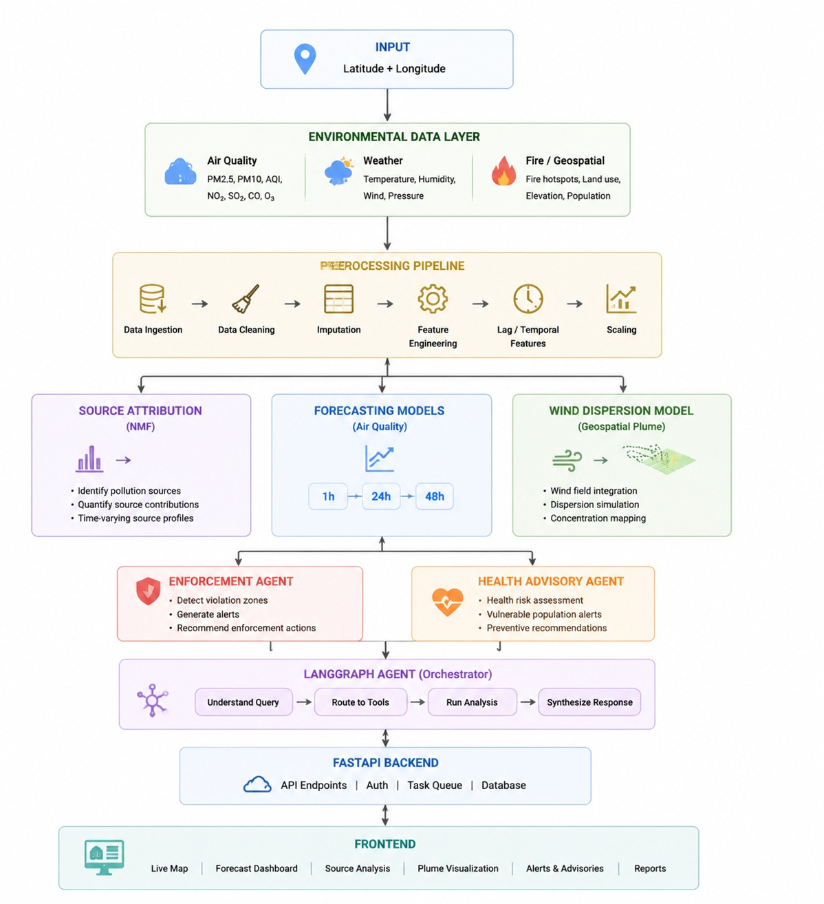

<div align="center">

# 🌍 Urban-Air-Unified



### AI-Powered Air Quality Forecasting, Autonomous Enforcement & Real-time Advisories

**ET AI Hackathon 2.0 Submission**

*Bridging the gap between sterile Data Science and real-time Production environments.*

---


---

**An Orchestrator Backend capable of ingesting live meteorological internet data, predicting AQI spikes using Machine Learning, calculating wind-plume physics, querying physical city infrastructure via OpenStreetMap, and executing autonomous enforcement agents.**

[System Architecture](docs/ARCHITECTURE.md) • [API Endpoints](docs/API_ENDPOINTS.md) • [Machine Learning](docs/MACHINE_LEARNING.md) • [Frontend Guide](docs/FRONTEND_NOTES.md)

</div>

---

- [🚨 The Problem Statement](#problem-statement)
- [✨ The Innovation: Static CSVs vs Live Production](#innovation)
- [🚀 Hackathon Completion Matrix](#completion-matrix)
- [📂 Repository & Submodule Structure](#repository-structure)
- [▶️ Installation & Cloning (Important!)](#installation)
- [👥 Team & Acknowledgements](#team)

---

<a id="problem-statement"></a>
# 🚨 The Problem Statement

Current AQI dashboards only report **how polluted** the air is. They do not explain **why**, nor do they generate actionable intelligence. 
Our ML Data Science team built models capable of predicting pollution and identifying the sources (Traffic vs Industry).

**The Backend Challenge:** How do we take those heavy `.pkl` ML models out of a sterile Jupyter Notebook and deploy them to the real world? How do we use them to autonomously warn vulnerable citizens and deploy police/inspectors to the right factories?

---

<a id="innovation"></a>
# ✨ The Innovation: Static CSVs vs Live Production

This backend serves as a massively scalable **FastAPI Orchestrator**.

1. **Live Open-Meteo Ingestion:** We eradicated the dependency on static `.csv` files. The backend actively scrapes 168 hours of live weather data from the internet for any GPS coordinate, automatically imputes broken sensors, and executes real-time XGBoost inference.
2. **Geospatial Plume Modeling:** We built a `geopy` physics engine that converts live wind speed and direction into a GeoJSON pollution plume so the frontend can render wind-blown smoke.
3. **OSMnx Vulnerability & Enforcement Mapping:** We integrated OpenStreetMap. If the ML predicts a pollution spike, the backend physically scans a 2km radius to map schools, hospitals, and offending factories, scoring them by Haversine distance.
4. **Neural Text-to-Speech:** Integrated `edge-tts` (Microsoft Azure Neural) to generate highly realistic, British-accented `.mp3` audio advisories on the fly.
5. **LangGraph LLM Supervisor:** Deployed a Generative AI ReAct agent (`gpt-4o-mini`) that can converse with users and autonomously call the tools above.

---

<a id="completion-matrix"></a>
# 🚀 Hackathon Completion Matrix

By integrating the ML submodules into this unified backend, **we have officially completed 100% of the planned Hackathon roadmap.**

| Problem Statement Requirement | Data Science Status | Unified Backend Status |
|-------------------------------|:---:|:---:|
| **1. Source Attribution Engine** | ✅ Model Built | ✅ **Production API** |
| **2. Predictive AQI Forecasting** | ✅ Model Built | ✅ **Live Internet Ingestion** |
| **3. Enforcement Intelligence Agent** | 🚧 WIP | ✅ **Completed** (via OSMnx mapping) |
| **4. Multi-City Dashboard** | 🚧 WIP | ✅ **Completed** (via TinyDB Analytics) |
| **5. Citizen Health Advisory** | 🚧 Planned | ✅ **Completed** (via Azure edge-tts) |
| **LangGraph Multi-Agent Workflow**| 🚧 WIP | ✅ **Completed** (Deployed on `/chat`) |
| **Real-Time Sensor Integration** | 🚧 Planned | ✅ **Completed** (via Open-Meteo async) |

---

<a id="repository-structure"></a>
# 📂 Repository Structure

This repository uses Git Submodules to cleanly separate the Machine Learning research environment from the Backend Production environment.

```text
├── Urban-Air-Intelligence/          # (Submodule) The Data Science research, Jupyter notebooks, and training data
├── ETAgent/                         # (Submodule) The Agentic research environment
├── unified_backend/                 # The Production FastAPI Application
│   ├── app/                         
│   │   ├── api/                     # FastAPI Routers (ML, Health, Agents, Analytics)
│   │   ├── services/                # Microservices (Live Ingestion, Plumes, OSMnx, LangGraph)
│   │   └── core/                    # TinyDB Database initialization
│   └── submodules/                  # Symlinks to the trained .pkl models inside the submodules
├── docs/                            # The Massive 700+ line documentation hub
├── pyproject.toml                   # Root Dependency definitions
└── README.md
```

---

<a id="installation"></a>
# ▶️ Installation & Cloning (Important!)

Because this repository relies on Git Submodules (to pull in the ML team's trained models), you **must** clone it recursively.

### 1. Clone the Repository
```bash
git clone --recurse-submodules https://github.com/CyberKnight-cmd/Urban-Air-Unified.git
cd Urban-Air-Unified
```
*(If you already cloned it normally, run `git submodule update --init --recursive` to pull the models).*

### 2. Install Dependencies (Using `uv`)
We manage our Python virtual environment at the root of the project using `uv` for blazing-fast installations.
```bash
uv sync
```

### 3. Add API Keys
The LangGraph Supervisor route requires an OpenAI API key.
```bash
cp unified_backend/.env.example unified_backend/.env
# Open unified_backend/.env and add your OPENAI_API_KEY
```

### 4. Start the Production Server
Change directories into the backend so relative paths work correctly, and run the server. `uv` will automatically detect the root virtual environment!
```bash
cd unified_backend
uv run uvicorn app.main:app --host 0.0.0.0 --port 8000 --reload
```
Navigate to **`http://localhost:8000/docs`** to access the interactive Swagger API!

---

<a id="team"></a>
# 👥 Team Outlaws
* **Shinjan Saha**
* **Arya Gupta**
* **Srijan Sarkar**
* **Pritam Paul**

<div align="center">
  <h3>⭐ If you found this architecture impressive, consider giving it a star!</h3>
  <p>Made with ❤️ for ET AI Hackathon 2.0</p>
</div>
