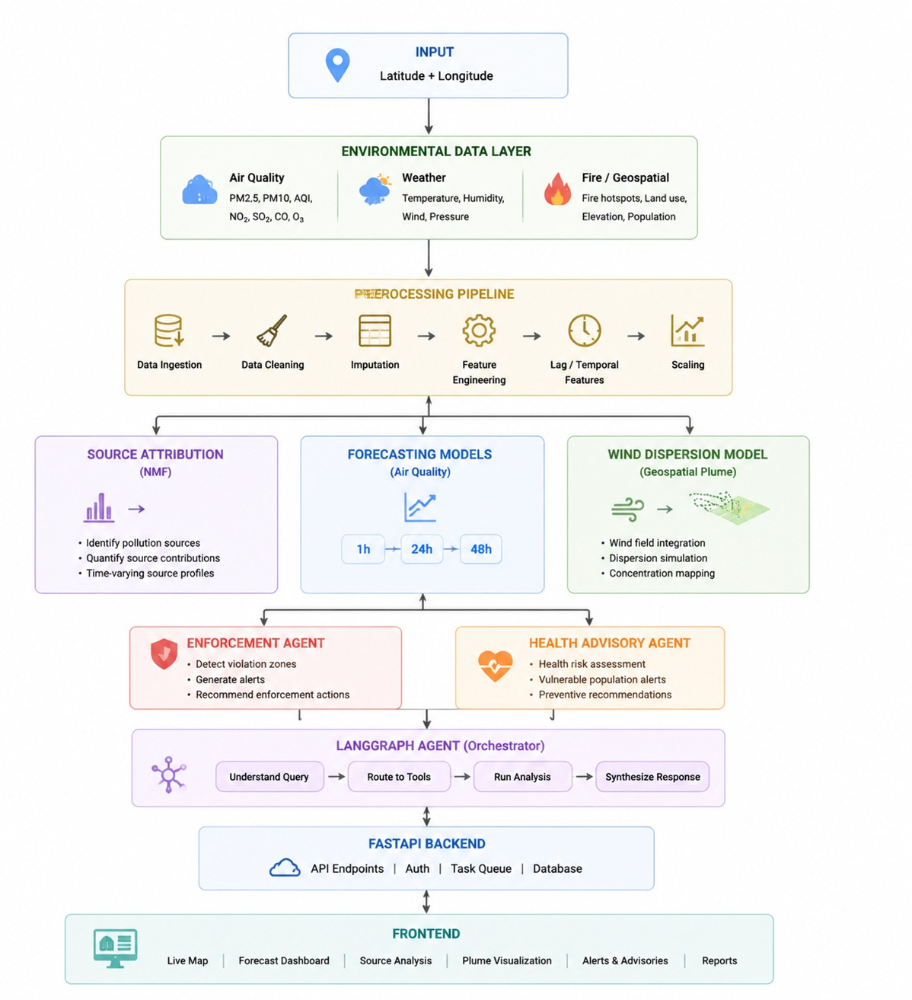

  
# 🌍 Urban-Air-Unified
## Next-Generation Autonomous Air Quality Management System
  
**A Comprehensive Technical Pitch & Architecture Whitepaper**

 

---

## 1. Executive Summary

Urban-Air-Unified represents a paradigm shift in environmental governance. Traditional air quality systems are fundamentally reactive—they report pollution only *after* citizens have already breathed it. They provide numbers, but no actionable context, leaving municipalities blind to the sources of pollution and incapable of targeted enforcement.

**Urban-Air-Unified** is a proactive, end-to-end AI platform. It ingests live meteorological data, engineers complex time-series features, and runs them through advanced Machine Learning models (XGBoost & LightGBM) to forecast AQI up to 48 hours in advance. It doesn't just predict the pollution—it uses **Non-Negative Matrix Factorization (NMF)** to attribute the exact percentage of pollution caused by specific sectors (e.g., Traffic, Industrial, Biomass). 

Finally, a LangGraph-powered **AI Supervisor (Gemini 2.5 Flash)** synthesizes this data with live OpenStreetMap geospatial intelligence to identify vulnerable populations, generate localized health advisories with Text-to-Speech (TTS), and orchestrate real-world municipal enforcement targets.

---

## 2. System Architecture

*Figure 1: The Unified Backend Architecture, illustrating the flow from data ingestion to autonomous AI enforcement.*

The system is built on a high-performance, async **FastAPI** orchestrator. It is entirely modular, allowing the ML pipelines, the geospatial engine, and the Generative AI agents to scale independently.

### **Core Modules:**
1. **The Ingestion Engine**: Dynamically fetches 168 hours of trailing weather and pollution data from Open-Meteo APIs for any GPS coordinate globally.
2. **The ML Pipeline**: 
   - **Imputation**: Utilizes `MissForest` (backed by LightGBM) to seamlessly handle missing or corrupt sensor data.
   - **Forecasting**: A pre-trained `XGBoost` regressor outputs 1h, 24h, and 48h PM2.5 forecasts.
   - **Attribution**: NMF identifies the latent signatures of different pollution sources.
3. **The Plume Modeler**: Calculates wind-dispersion mechanics using live wind speed and direction, generating GeoJSON pollution plumes.
4. **The Geospatial Enforcement Engine**: Uses `OSMnx` to perform bounding-box queries against OpenStreetMap, correlating the ML source attribution (e.g., "50% Industrial") with physical real-world coordinates (e.g., specific factories) to generate enforcement targets.
5. **The Health Advisory System**: Maps local vulnerable infrastructure (hospitals, schools) and uses `edge-tts` (Azure Neural Voices) to generate multilingual, playable `.mp3` audio warnings.

---

## 3. The Problem with the Status Quo

### ❌ Reactive, Not Proactive
Current systems (like standard government AQI dashboards) only tell you that the air is bad right now. They do not give citizens enough lead time to close windows, alter commutes, or protect vulnerable groups.

### ❌ Zero Actionable Attribution
Knowing the AQI is 300 is useless for a city planner if they don't know *why*. Is it a nearby factory? Is it a sudden influx of heavy traffic? Without source attribution, enforcement is impossible.

### ❌ Disconnected Systems
Currently, ML forecasting, GIS mapping, and policy enforcement live in completely separate silos. Data scientists build models that policymakers never know how to use.

---

## 4. The Urban-Air-Unified Solution

By bridging the gap between Data Science and Municipal Enforcement, Urban-Air-Unified provides a unified dashboard backend:

* **Predictive Dominance**: We forecast pollution events before they happen.
* **Pinpoint Enforcement**: If the ML detects a surge in industrial pollution, the AI automatically queries OSM for nearby factories, calculates their distance to the pollution epicenter, and scores them for immediate municipal inspection.
* **Automated Empathy**: The system automatically locates nursing homes and schools in the path of the pollution plume and synthesizes urgent, localized audio warnings.

---

## 5. Technology Stack

We selected a cutting-edge, lightweight, and incredibly fast technology stack designed for production environments:

* **Backend Framework**: `FastAPI` (Python)
* **Machine Learning**: `scikit-learn`, `xgboost`, `lightgbm`, `joblib`
* **Geospatial Intelligence**: `osmnx`, `geopy`, `geojson`
* **Autonomous AI Agents**: `langgraph`, `langchain-google-genai` (Gemini 2.5 Flash)
* **Audio Synthesis**: `edge-tts` (Microsoft Azure Cognitive Services)
* **Database**: `TinyDB` (for fast, portable document analytics)
* **Package Management**: `uv` (for sub-second dependency resolution)

---

## 6. Business Impact & Feasibility

**Urban-Air-Unified** is not a theoretical concept; it is a fully functioning backend ready to be deployed via Docker to AWS or Azure. 

For a municipality, the ROI is massive:
1. **Reduced Healthcare Burden**: By giving vulnerable populations 48 hours of advance warning, hospital admissions for respiratory issues drop significantly.
2. **Efficient Enforcement**: Instead of sending inspectors out blindly, cities can deploy their limited workforce to the exact factories or intersections flagged by the AI.
3. **Citizen Trust**: The automated IVR audio advisories and multi-lingual support democratize environmental data, making it accessible to all demographics, not just smartphone users.

---

## 7. Future Roadmap

While the hackathon deliverable is fully functional, the roadmap for V2 includes:
* **IoT Sensor Integration**: Moving beyond Open-Meteo to ingest live MQTT streams from cheap, custom-built hardware sensors.
* **Digital Twin Integration**: Pushing the GeoJSON plumes into a 3D CesiumJS digital twin of the city.
* **WhatsApp Bot**: Linking the LangGraph Supervisor to a Twilio endpoint for instant citizen Q&A over WhatsApp.

**Welcome to the future of environmental intelligence.**
